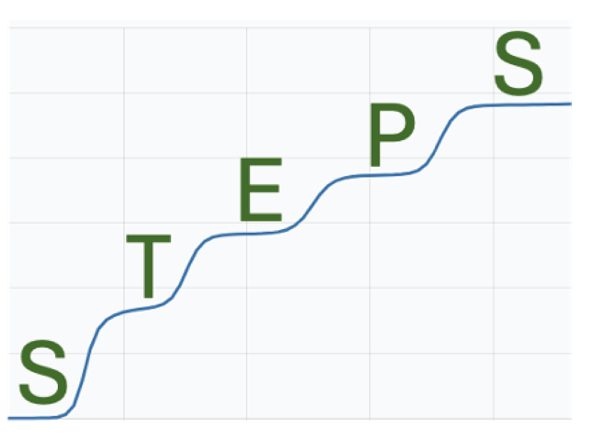

# STEPS

Inspired by [The Long-Term Evolution Experiment](https://the-ltee.org), Serially Transferred Evolving Population Simulator (aka STEPS) models the dynamics of asexual populations as they grow and evolve throughout a serial transfer experiment. Information regarding how to install, compile, and run STEPS can all be found in the [User Manual](https://github.com/zachmatson/STEPS/blob/main/STEPS_User_Manual.pdf) file along with other helpful information such as: example runs and how to interpret them, core assumptions made by model, and a walk through of [web-based version](https://steps.the-ltee.org). Basic installation, run, and compilation instructions can also be found below.

STEPS simulations can be run and visualized in-browser, without installation, from the [STEPS Portal](https://steps.the-ltee.org). Data from the portal can also be downloaded for further analysis. Some advanced features, such as sequencing data, are not available from the portal.

<p align="center">
  
</p>

## Instructions to build and run:

1. Install Rust and Cargo using [rustup](https://www.rust-lang.org/tools/install)
2. Navigate to the root directory of the project
3. Compile as described below
4. Test your local build with `cargo test`
4. Run `./target/release/steps help` or `./target/debug/steps help` for usage instructions

## Compilation Options

Basic compilation (release mode is recommended for performance):
```sh
cargo build --release
```

To target the specific CPU of your machine and allow for better optimization, use:
```sh
RUSTFLAGS="-C target-cpu=native" cargo build --release
```

A binary compiled with `target-cpu=native` may not run on different machines with different CPUs. If you are running STEPS across various CPU types, such as in a heterogenous compute cluster, you should compile it separately on each machine where you plan to run it.

## Examples

The `core/examples` directory contains self-contained programs that use STEPS as a library, each writing CSV to standard output:

| Example | What it does |
| --- | --- |
| `fitness_trajectory` | Average fitness of each replicate after every transfer |

Run one with `cargo run --release --example fitness_trajectory`, and redirect to a file to analyse the output:

```sh
cargo run --release --example fitness_trajectory > trajectory.csv
```

## Building/running the Portal

To test changes to the Portal while developing:
```sh
# in portal subdirectory
$ npm install && npm run start
```

To test the production Portal build before pushing Portal changes:
```sh
# in portal subdirectory
$ npm install && npm run start:prod
```

## Building JOSS Paper

To build the [paper submitted to JOSS regarding this project](https://github.com/openjournals/joss-reviews/issues/10300), run `./JOSS/generate_paper.sh` from the project root. This file is generated locally and not tracked. The latest generated version of this paper can be accessed as an artifact from the "Draft PDF" GitHub workflow in this repository.

## Contributing to STEPS

We welcome contributions from the community! Please see [CONTRIBUTING.md](CONTRIBUTING.md) before contributing.

You may also report issues with STEPS by filing an issue in this GitHub repository.

